# Máquinas de estado implícitas

## Alcance y método

**Definición.** Una máquina de estado implícita es una parte del código donde
una entidad pasa por un conjunto finito de estados a lo largo del tiempo. El
código no modela ese conjunto como un tipo cerrado con una única función de
transición. El estado vive en otra forma: un hash en un payload, la presencia
de un fichero, una fila en un JSONL, una combinación de campos opcionales, una
variable local de un bucle o el orden de los eventos de un stream.

**Método.** Primero leí las instrucciones de la raíz del repositorio,
`README.md`, `docs/DEPLOYMENT.md` y `docs/FIGURAS.md`. Después leí completo el código de `backend/src/rag/`,
`frontend/src/`, `tools/figuras/`, `frontend/nginx.conf`, `docker-compose.yml`,
`backend/Dockerfile`, `backend/eval/run_eval.py` y la cabecera de
`backend/e2e/run_e2e.py`. Busqué contadores, flags booleanos, campos `| None`,
ficheros de "hechos", marcadores de texto, bucles con variables de modo y
recursos que dos procesos leen y escriben. Comprobé cada referencia
`ruta:línea` contra el código. No ejecuté nada.

**Estado tras los arreglos.** Una segunda pasada arregló parte de los
riesgos. Cada riesgo arreglado lleva la marca **Arreglado** con su commit. Las
referencias `ruta:línea` describen el código después de esos commits. Los
riesgos sin marca siguen abiertos; la sección final explica por qué.

**Convención de riesgos.**

- *verificado*: el comportamiento se deduce de leer el código.
- *hipótesis*: el comportamiento depende de condiciones externas (Qdrant,
  Ollama, Docker, SLURM, red) o de datos que no vi.

Las secciones van de mayor a menor importancia.

## Resumen

| # | Máquina | Codificación del estado | Archivo principal | Riesgo principal |
|---|---|---|---|---|
| 1 | Ciclo de vida de un documento en el índice | `source_hash` del payload contra el `.md`, más flags de la corrida | `backend/src/rag/ingestion/indexer.py` | Renombrado masivo: la purga retenida deja dos copias de cada contrato (el documento vaciado está arreglado) |
| 2 | Versión de un documento entre Khipu, Mac e índice | Contenido del `.md`, sello del frontmatter, listas `.txt` por oleada | `tools/figuras/aplicar_oleada.sh`, `fusionar_figuras.py` | El índice no sabe qué versión del `.md` tiene (los fallos de reindexado ya no se ocultan) |
| 3 | Bucle agéntico y resultado de la respuesta | `TypedDict` parcial: `scope`, `no_context`, `grounded`, `claims_total` | `backend/src/rag/graph/agent.py` | Rechazo y Sin verificar comparten campos en el evento `end` (`no_context` ya sale con `grounded: null`) |
| 4 | Veredicto por afirmación del verificador | Listas de `(estado, motivo)` por afirmación en dos rondas | `backend/src/rag/graph/agent.py` | Precedencia Sustentada sobre Refutada (el tope de 25 ya se informa) |
| 5 | Protocolo SSE de `/api/chat` | Orden de eventos de LangGraph, flag `sources_sent`, dict `final` | `backend/src/rag/api/main.py` | `final` duplica el estado del grafo (la cuota ya se devuelve si el agente falla) |
| 6 | Mensaje del asistente en el frontend | Campos opcionales de `ChatMessage` | `frontend/src/App.tsx` | El paso del agente se oculta al llegar el texto (la respuesta detenida ya se marca) |
| 7 | Cadena SLURM de lectura y verificación | Filas sin `error` en dos JSONL, sucesor en la cola | `tools/figuras/figuras_job.slurm` | Sucesor congelado con el `.slurm` del `sbatch` (el estado terminal ya existe) |
| 8 | Estado de una página en el pipeline de figuras | Presencia de `.jpg`, filas JSONL, cabecera en el `.md` | `tools/figuras/prep_figuras.py`, `extraer_figuras.py` | Dos lecturas de una clave comparten la verificación de la vieja (el worklist ya no pierde filas) |
| 9 | Fusión en el vault por oleadas | El propio texto del `.md` (cabeceras y marcadores) | `tools/figuras/fusionar_figuras.py` | Bloques de formato viejo sin salida salvo el cierre |
| 10 | Procedencia de las lecturas en el chunker | Variables locales `activa` y `ultima` | `backend/src/rag/ingestion/chunker.py` | Bloque sin cierre marca el resto del documento como lectura de máquina |
| 11 | Esquema de puntos y colección en Qdrant | Presencia de `*_norm`, grafía de `tipo`, dimensión fija | `backend/src/rag/ingestion/indexer.py` | Cambio de embedder sin registro; backfill sin llamador |
| 12 | Cuota diaria por IP | Filas `(ip, day, count)` en SQLite | `backend/src/rag/api/quota.py` | Sana; un corte o Detener siguen consumiendo el intento, por diseño |
| 13 | Salud del servicio | Dict `out` con `status` y un campo por componente | `backend/src/rag/api/main.py` | No prueba DeepSeek (la colección ausente ya se informa aparte) |
| 14 | Bucles de reintento | Contador `attempt` / `intento` | `embedder.py`, `extraer_figuras.py` | Sanos en el proceso; entre procesos los acota la cadena SLURM (ver 7) |

---

## 1. Ciclo de vida de un documento en el índice

**Propósito.** En cada corrida de `sein-rag-ingest` decide si un documento del
vault se salta, se reindexa, falla o se purga.

**Dónde.**

- `backend/src/rag/ingestion/indexer.py:262` `ingest_vault`.
- `indexer.py:283` lee `existing` (doc_id a `source_hash`) desde Qdrant, también con `--force`.
- `indexer.py:292-310` un documento ilegible (`OSError`) cuenta como fallido y como visto (`indexer.py:294-301`); un documento vacío cuenta como fallido y no como visto (`indexer.py:302-310`).
- `indexer.py:317-323` condición de salto.
- `indexer.py:337-340` embeber, borrar la versión vieja y hacer upsert.
- `indexer.py:368-376` aviso de los doc_id de `--reindexar-lista` que no están en el vault.
- `indexer.py:378` cálculo de `stale`; `indexer.py:383-426` `_purge_stale` con sus frenos.
- `indexer.py:64-66` `IngestStats.ok`.
- `backend/src/rag/ingestion/loader.py:67-77` `read_document` lanza `OSError` si no lee el fichero y `EmptyDocumentError` si el cuerpo está vacío; `loader.py:55-64` `load_document` devuelve `None` en los dos casos; `loader.py:79-85` hash de respaldo sin `source_hash`.
- `backend/src/rag/ingestion/chunker.py:44-45` id `uuid5(doc_id|source_hash|i)`.
- `backend/src/rag/ingestion/cli.py:79` `--allow-purge` sube el umbral a 1.0; `cli.py:98` código de salida.

**Codificación.** No hay campo de estado. El estado de un documento es la
relación entre tres hechos: el `.md` existe y tiene cuerpo, el mapa `existing`
que se reconstruye del payload de Qdrant, y los flags de la corrida (`force`,
`forzados`, `max_purge_ratio`). El veredicto de la corrida combina dos
contadores: `failed == 0 and purge_skipped == 0`.

**Estados y transiciones.**

| Estado | Condición | Disparador de salida |
|---|---|---|
| Nuevo | `.md` legible, doc_id fuera de `existing` | Corrida: pasa a Reindexando |
| AlDia | Mismo hash en vault e índice | Hash distinto, `--force` o doc en `--reindexar-lista` |
| Cambiado | Hash distinto | Corrida: pasa a Reindexando |
| Reindexando | Transitorio: chunk, embed, delete, upsert | Éxito: AlDia. Excepción: Fallido |
| FallidoSinVersion | Era Nuevo y falló | Siguiente corrida lo reintenta |
| FallidoConVersionVieja | Tenía versión y falló antes del borrado | Siguiente corrida lo reintenta; la versión vieja sigue servida |
| Ilegible | Indexado; el `.md` existe y no se puede leer | Siguiente corrida que lo lea |
| Vaciado | Indexado; el `.md` existe y queda sin cuerpo | Purga como un Huerfano, o Retenido por los frenos |
| Huerfano | En el índice, sin `.md` | Purga, o Retenido por los frenos |
| PurgaRetenida | Vault vacío, o más del 50 % sin `--allow-purge` | Corrida con `--allow-purge` y vault no vacío |
| Purgado | Terminal | Ninguno |

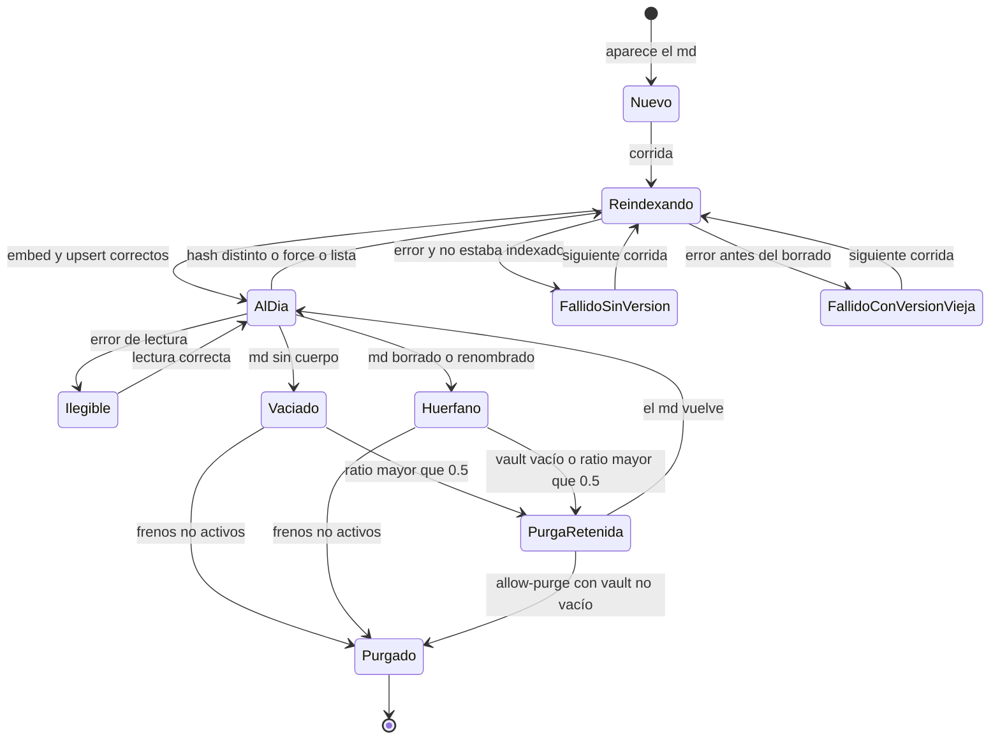

**Invariantes.**

- Una sola generación por doc_id. Se cumple: el borrado por doc_id va antes del upsert (`indexer.py:338-340`) y `existing` se consulta siempre (`indexer.py:283`).
- Embeber antes de borrar (`indexer.py:337`). Se cumple: un fallo del embedder deja la versión vieja.
- Un documento presente pero ilegible no se purga (`indexer.py:300`). Se cumple.
- Un documento vaciado no conserva su versión vieja (`indexer.py:302-310`). Se cumple, con los frenos de purga.
- Frenos de purga: vault vacío (`indexer.py:401`) y ratio (`indexer.py:410-411`). Se cumplen. `--allow-purge` no salta el freno del vault vacío.
- Ids deterministas (`chunker.py:44-45`). Se cumple.
- `source_hash` describe el contenido del `.md`. **No se cumple**: es el hash del PDF. Ver máquina 2.

**Riesgos.**

1. *verificado*. Ventana de ausencia. Entre el borrado con `wait=True` (`indexer.py:339`) y el upsert (`indexer.py:340`) el documento no existe para la API. Con `--force` la ventana se repite una vez por documento. Una consulta en ese momento no ve el documento, y `find_extreme_docs` (`backend/src/rag/retrieval/store.py:265`) puede elegir otro como "el más reciente".
2. *verificado*. Estado Zombi. Un documento indexado cuyo `.md` queda vacío conservaba su versión vieja sin límite de tiempo, porque se marcaba como visto. Cada corrida sale con 1. El E2E probaba solo un vacío nuevo (`backend/e2e/run_e2e.py:476-494`), sin versión previa.
   **Arreglado** (commit `3da35b2`): un `.md` vaciado ya no cuenta como visto y su versión entra en la purga con los mismos frenos; el E2E lo prueba (`run_e2e.py:695-715`). La corrida sigue saliendo con 1 mientras el fichero esté vacío, como pide el E2E para cualquier documento vacío.
3. *verificado*. Renombrado masivo. Si cambian más de la mitad de los doc_id (por ejemplo, al reorganizar carpetas), las versiones nuevas se indexan dentro del bucle y la purga posterior se retiene. El índice queda con dos copias de cada contrato bajo doc_id distintos. El código de salida 1 avisa, pero el retrieval ya sirve duplicados.
4. *hipótesis*. Caída a mitad de upsert. Si Qdrant aplica solo parte de los puntos, `existing` ya muestra el hash nuevo y la siguiente corrida salta el documento incompleto. El código no compara el número de chunks. Una caída o una excepción entre borrado y upsert sí se repara sola: el documento sale de `existing` y vuelve como Nuevo en la siguiente corrida. Hasta entonces (30 min con launchd) el documento falta en el índice.
5. *hipótesis*. Corridas concurrentes. No hay cerrojo. launchd lanza la ingesta cada 30 min (`docs/DEPLOYMENT.md`) y `aplicar_oleada.sh` lanza otra `docker compose run`. Con el mismo vault convergen por los ids deterministas. Con un vault que cambia en medio (rsync), el resultado depende del orden.
6. *verificado*. El manifiesto solo registra `indexed` y `failed` (`indexer.py:350`, `indexer.py:363`). Saltos, purgas y purgas retenidas no dejan línea. Ningún código lee el manifiesto.
7. *verificado*. Un doc_id de `--reindexar-lista` que no existe en el vault se ignoraba sin aviso (`cli.py:55-60`, `indexer.py:317-320`).
   **Arreglado** (commit `3da35b2`): la ingesta registra un WARNING con los doc_id de la lista que no están en el vault (`indexer.py:368-376`).

---

## 2. Versión de un documento entre Khipu, Mac e índice

**Propósito.** Llevar un `.md` enriquecido desde el vault de Khipu hasta el
índice que consulta la API.

**Dónde.**

- `tools/figuras/fusionar_figuras.py:283-287` escritura del `.md` en Khipu.
- `fusionar_figuras.py:406-416` listas `docs_a_reindexar.txt` y `docs_con_figura.txt`.
- `fusionar_figuras.py:85-99` sello `figuras_leidas` en el frontmatter.
- `tools/figuras/aplicar_oleada.sh:21` `pipefail`; `:32-38` fusión; `:48-52` rsync; `:60-81` elección de la lista; `:89-92` reindexado; `:96` verificación.
- `tools/figuras/cierre.sh:15` `pipefail`; `:36-45` comprobación del respaldo y restauración; `:50-56` fusión; `:68-70` reconstrucción del backend; `:79-92` reindexado por sello y por la lista de la fusión.
- `backend/src/rag/ingestion/indexer.py:317-323` salto por hash; `indexer.py:215-240` payload sin hash del `.md` ni sello.

**Codificación.** No existe un registro central. El estado se reparte entre el
`.md` de Khipu, su copia en el Mac (un rsync externo cada 2 h, según
`docs/FIGURAS.md`), el sello del frontmatter, dos listas `.txt` que cada
oleada sobrescribe y el payload de Qdrant. El payload guarda `source_hash`, que
es el hash del PDF. Ese hash no cambia con el enriquecimiento.

**Estados y transiciones.**

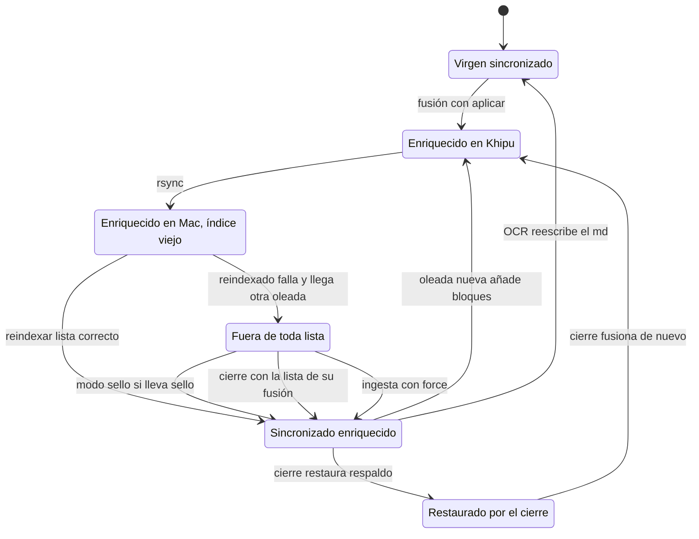

- Un documento que solo pierde marcadores falsos llega a M1 sin sello.
- El modo por defecto reindexa `docs_con_figura.txt`. El modo `todo` reindexa `docs_a_reindexar.txt`.
- El modo `sello` reindexa solo los documentos con `figuras_leidas`. El cierre reindexa esos y los de la lista de su fusión.

**Invariante.** El índice refleja el vault. **No se cumple de forma
automática**: la ingesta normal salta el documento porque el hash del PDF no
cambió (`indexer.py:317-323`). Solo `--reindexar-lista` o `--force` mueven el
documento al índice.

**Riesgos.**

1. *verificado*. El fallo del reindexado se ocultaba. `aplicar_oleada.sh` y `cierre.sh` pasan la ingesta por `| tail`. Con zsh y sin `pipefail`, el estado de la tubería era el de `tail`. El propio script describe este fallo para rsync (`aplicar_oleada.sh:44-47`) y lo repetía con la ingesta. El código de salida final era el de `verificar_enriquecimiento.py`, que mira el vault y no el índice.
   **Arreglado** (commit `7bfe817`): los dos scripts usan `set -uo pipefail`, y un fallo de la ingesta o del build corta el script con 1 (`aplicar_oleada.sh:89-92`, `cierre.sh:68-70`, `cierre.sh:89-92`).
2. *verificado*. Los documentos que solo pierden marcadores quedan en P. `docs_a_reindexar.txt` se calcula contra el vault actual (`fusionar_figuras.py:283`, `:406-408`). En la oleada siguiente ese documento ya no cambia y no aparece. El modo `sello` tampoco lo incluye, porque no lleva sello. El índice conservaba los `` alucinados de esos documentos hasta un `--force`.
   **Arreglado** (commit `7bfe817`): el cierre reindexa también la lista `docs_a_reindexar.txt` de su propia fusión, que parte del vault virgen y nombra todo documento cambiado (`cierre.sh:79-85`). Entre oleadas el documento sigue en P hasta el cierre.
3. *verificado*. Ningún proceso responde a la pregunta "qué versión del `.md` tiene el índice". El payload no guarda un hash del `.md` ni el sello (`indexer.py:215-240`).
4. *hipótesis*. `cierre.sh:36` restaura el respaldo más antiguo. Si el OCR reescribió un documento después del respaldo, el cierre lo devuelve a la versión anterior con su `source_hash` anterior. La ingesta normal lo ve Cambiado y reindexa el contrato viejo. Los PDF del registro no se editan en operación normal (`docs/FIGURAS.md`, "Qué sobrevive a qué"), así que la probabilidad es baja.
5. *hipótesis*. Ventana del cierre. Entre la restauración (`cierre.sh:45`) y la fusión (`cierre.sh:50-56`) el vault de Khipu está virgen. Si el rsync periódico corre en ese momento, el Mac recibe el vault virgen. La ingesta periódica salta por hash. Un reindexado manual en esa ventana indexaría la versión virgen.
6. *verificado*. `cierre.sh:68-70` reconstruye y reinicia el backend. Esa acción corta cualquier stream SSE en curso.
7. *verificado*, menor. `figuras_leidas` guardaba las inserciones de la pasada actual. Un documento que ganaba una figura en la segunda oleada pasaba de 3 a 1.
   **Arreglado** (commit `7bfe817`): el sello cuenta todos los bloques del documento con `YA_INSERTADO_RE` (`fusionar_figuras.py:277-281`).

---

## 3. Bucle agéntico y resultado de la respuesta

**Propósito.** Llevar una pregunta por análisis, recuperación, evaluación,
reformulación, generación y verificación, o cortarla antes.

**Dónde.**

- `backend/src/rag/graph/agent.py:739-767` construcción del grafo.
- `agent.py:276-379` `analyze`; `agent.py:293` cinturón de alcance; `agent.py:298` filtros de la UI sobre los extraídos; `agent.py:328-363` selector temporal.
- `agent.py:381-429` `retrieve` con dos modos y dos reintentos sin filtros (`agent.py:394-398`, `agent.py:419-428`).
- `agent.py:431-463` `grade`; `agent.py:433` omite el grading en modo multi-documento; `agent.py:456` fallback permisivo.
- `agent.py:465-479` `rewrite`; `agent.py:709-715` `after_grade`.
- `agent.py:696-705` `no_context`; `agent.py:728-737` `refuse`.
- `backend/src/rag/graph/state.py:10-37` `AgentState`, `TypedDict` con `total=False`.
- `backend/src/rag/config.py:74` `max_query_rewrites = 2`.

**Codificación.** La topología es explícita: un `StateGraph`. El resultado es
implícito. Lo define la combinación de `scope`, `no_context`, `grounded`,
`claims_total`, `claim_issues` y `relevant_documents`. El modo del bucle vive
en el contador `rewrites` y en si `relevant_documents` está vacío.

**Estados y transiciones.**

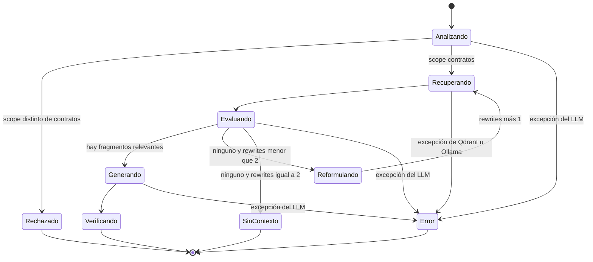

Resultados terminales, tal como llegan en el evento `end`:

| Resultado | `grounded` | `no_context` | `claims_total` | `claim_issues` |
|---|---|---|---|---|
| Rechazo (fuera de tema o volcado) | `null` | `false` | 0 | vacío |
| Sin contexto | `null` | `true` | 0 | vacío |
| Verificada | `true` | `false` | mayor que 0 | vacío |
| Refutada | `false` | `false` | mayor que 0 | con alguna `refutada` |
| No concluyente | `null` | `false` | mayor que 0 | sin `refutada`, o `claims_unchecked` mayor que 0 |
| Sin verificar | `null` | `false` | 0 | vacío |

**Invariantes.**

- El bucle termina. Se cumple: `after_grade` corta en `max_query_rewrites` (`agent.py:712`).
- Los filtros de la UI mandan y nunca se relajan. Se cumple: `agent.py:298`, `agent.py:394`, `agent.py:421-423`.
- El grading ante una respuesta ilegible del modelo deja pasar el fragmento (`agent.py:456`). Se cumple.

**Riesgos.**

1. *verificado*. `no_context` devolvía `grounded: true`. El frontend lo filtraba porque exige `total > 0` para la insignia (`frontend/src/components/Message.tsx:49`). `backend/eval/run_eval.py:56` suma `bool(grounded)`: cada "no está en el índice" contaba como respuesta fundamentada. El grounded rate subía cuando el retrieval empeoraba.
   **Arreglado** (commit `03c57b3`): `no_context` devuelve `grounded: None` (`agent.py:704`), y el eval deja de contarlo como fundamentado.
2. *verificado*. Rechazo y Sin verificar tienen la misma combinación de campos. Solo el texto de la respuesta los separa. Un cliente distinto del frontend no puede saber que la verificación no corrió.
3. *verificado*. Con filtros de la UI que dejan cero resultados, `rewrite` cambia solo `search_query` (`agent.py:479`). Los filtros siguen. El agente gasta dos reformulaciones y dos búsquedas antes de Sin contexto. Esto ocurre con los puntos legados sin `*_norm` (máquina 11).
4. *verificado* el mecanismo, *hipótesis* el disparador. En modo multi-documento con selector temporal, el reintento sin filtros (`agent.py:394-398`) no comprueba si los `doc_id` vienen del selector. Si la búsqueda acotada devolviera vacío, el generador recibiría una `selector_note` que nombra N documentos y un contexto de otros. La búsqueda densa con filtro casi siempre devuelve puntos, así que el caso es raro.
5. *verificado*. No hay reintento ni fallback entre modelos o proveedores. El proveedor se fija al construir el agente (`backend/src/rag/llm.py:23`, `llm.py:41`). Solo `verify` atrapa excepciones (`agent.py:588`, `agent.py:619`). Un fallo en cualquier otro nodo termina en Error.
6. *verificado*. La búsqueda léxica cae a solo densa sin señal (`backend/src/rag/retrieval/store.py:249-251`). El modo degradado solo aparece como WARNING en el log. El agente, la API y el usuario no lo ven.

---

## 4. Veredicto por afirmación del verificador

**Propósito.** Contrastar cada afirmación de la respuesta contra el fragmento
que cita y resumir el resultado en `grounded`.

**Dónde.**

- `backend/src/rag/graph/agent.py:498-525` `_extract_claims`; `agent.py:522` descarta citas fuera de rango.
- `agent.py:527-563` `_refute`; `agent.py:559` acepta estados de `REFUTE_STATES`.
- `agent.py:565-694` `verify`: `agent.py:575-592` salidas tempranas; `agent.py:596-597` tope `MAX_CLAIMS` y `claims_unchecked`; `agent.py:603-608` asignación de la única fuente citada; `agent.py:634-651` segunda ronda; `agent.py:653-672` precedencia; `agent.py:674-680` veredicto global.
- `backend/src/rag/graph/prompts.py:243` `CLAIM_STATES`; `prompts.py:247` `REFUTE_STATES`.

**Codificación.** Cada afirmación es un dict `{texto, citas}`. Sus veredictos
son una lista de tuplas `(estado, motivo)` acumulada en dos rondas. El estado
final sale de una regla de precedencia. El veredicto global es un booleano de
tres valores (`True`, `False`, `None`).

**Estados y transiciones.**

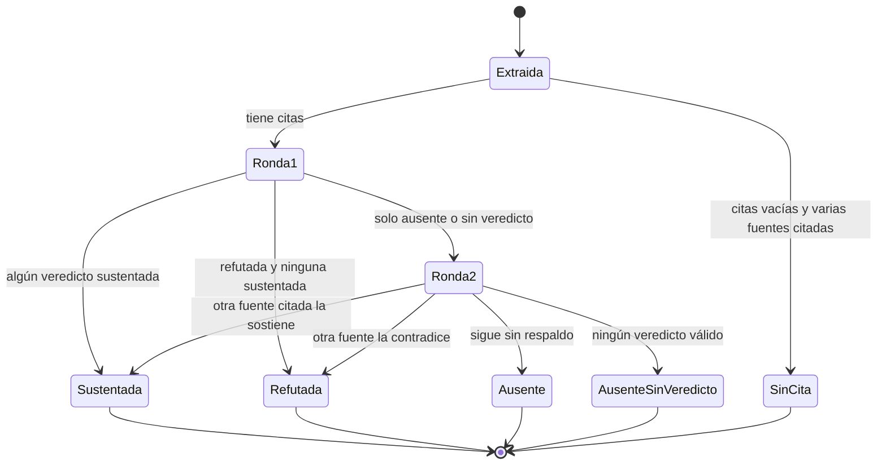

Veredicto global: `False` si alguna es Refutada; `True` si todas son
Sustentada y ninguna quedó fuera del tope; `None` en el resto. También `None` con `claims_total = 0` cuando no
hay documentos, no hay respuesta, el extractor falla o no devuelve nada.

**Invariantes.**

- Lo refutado no se reabre en la segunda ronda (`agent.py:637`). Se cumple.
- Una cita fuera de rango se descarta (`agent.py:522`). Se cumple.
- Un fallo del refutador nunca tumba la respuesta (`agent.py:619-624`). Se cumple, y degrada hacia No concluyente.

**Riesgos.**

1. *verificado*. Tope silencioso. `raw[:MAX_CLAIMS]` cortaba en 25. Si las 25 primeras se sostenían, `grounded` era `True` y la insignia decía "25 afirmaciones contrastadas". La interfaz no avisaba de las afirmaciones que no se contrastaron.
   **Arreglado** (commit `03c57b3`): las sobrantes se cuentan en `claims_unchecked` (`agent.py:596-597`), `grounded` no puede ser `True` con ellas y el frontend muestra "N afirmaciones sin contrastar" (`Message.tsx:67-75`).
2. *verificado* el mecanismo, *hipótesis* el impacto. Precedencia Sustentada sobre Refutada (`agent.py:666-670`). Una afirmación que un fragmento contradice y otro sostiene termina Sustentada. Si el fragmento que la sostiene es de otro contrato con la misma cifra, la atribución errónea puede pasar.
3. *verificado*, menor. El refutador podía devolver `sin_cita`. Ese valor se mezclaba con el `sin_cita` del extractor, aunque la afirmación sí tenía cita.
   **Arreglado** (commit `03c57b3`): `_refute` solo acepta `REFUTE_STATES` (`agent.py:559`, `prompts.py:247`); un `sin_cita` del refutador cuenta como sin veredicto.
4. *verificado*. Sin verificar llegaba al frontend sin ninguna insignia. El usuario no distinguía una respuesta que nadie verificó de una respuesta sin datos.
   **Arreglado** (commit `03c57b3`): una respuesta con fuentes, sin afirmaciones contrastadas y sin `no_context` lleva la marca "Sin verificar" (`Message.tsx:76-85`).

---

## 5. Protocolo SSE de `/api/chat`

**Propósito.** Transmitir el progreso del agente, las fuentes, los tokens y el
resultado final en un solo stream.

**Dónde.**

- `backend/src/rag/api/main.py:351` ruta con la dependencia `chat_access`; `main.py:185-204` `chat_access` decide quién paga; `main.py:207-224` `consume_quota` cobra; `main.py:354` cobro dentro del handler.
- `main.py:356-418` `event_stream`: `main.py:365-366` `final` y `sources_sent`; `main.py:371-372` `status`; `main.py:373-381` fusión de salidas y `sources`; `main.py:382-389` `token`; `main.py:390-405` `end`; `main.py:406-418` `error` y devolución del intento.
- `main.py:40-49` `STEP_LABELS` filtra los nombres de nodo.
- `frontend/src/api.ts:39-102` lector del stream; `frontend/nginx.conf:94-106` proxy sin buffering.

**Codificación.** No hay un tipo para la gramática del stream. El orden sale
de los eventos `on_chain_start` y `on_chain_end` de LangGraph filtrados por
nombre. Un flag local (`sources_sent`) evita repetir las fuentes. Un dict local
(`final`) reconstruye el estado del grafo fusionando la salida de cada nodo.

**Secuencias legales.**

- Antes del stream: respuesta HTTP 401, 422, 429 o 5xx sin SSE.
- Rechazo: `status(analyze)`, `status(refuse)`, `end`.
- Sin contexto: `status(analyze)`, de una a tres veces `status(retrieve) status(grade)` con `status(rewrite)` entre ellas, `status(no_context)`, `end`.
- Respuesta: igual hasta el último `grade`, luego `sources`, `status(generate)`, cero o más `token`, `status(verify)`, `end`.
- Cualquier prefijo puede terminar en `error`.

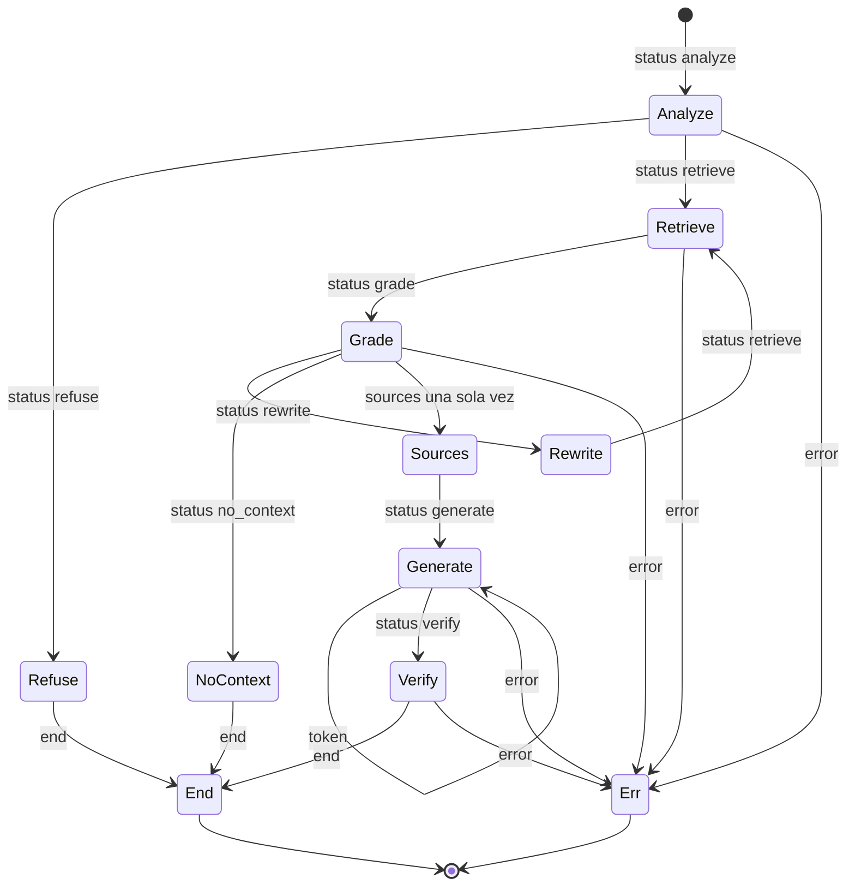

**Invariantes.**

- Un solo evento terminal (`end` o `error`). Se cumple por la estructura del generador, salvo desconexión o proceso muerto.
- `sources` como máximo una vez y antes de `generate` (`main.py:377`). Se cumple: un `grade` con fragmentos siempre lleva a `generate`.
- `end.sources` coincide con `relevant_documents` final (`main.py:397`). Se cumple.

**Riesgos.**

1. *verificado*. La cuota se consumía antes del stream: `chat_access` corría como dependencia y cobraba antes de validar el cuerpo, así que una petición mal formada (422) también gastaba un intento. Un error del agente, un corte de red o "Detener" no devolvían el intento.
   **Arreglado** (commit `65c2d78`): el intento se cobra dentro del handler, después de validar el cuerpo (`main.py:354`), y un error del agente lo devuelve (`main.py:410-414`, `quota.py:95-102`). Un corte de red o "Detener" siguen contando a propósito: devolverlos permitiría preguntas gratis abandonándolas a medias.
2. *hipótesis*. Desconexión del cliente. Starlette cancela el generador. `except Exception` (`main.py:406`) no atrapa la cancelación, así que no se emite `error` y la cancelación llega a la llamada httpx en curso. Las búsquedas que corren en `asyncio.to_thread` (`agent.py:379-427`) terminan en su hilo. Si Ollama detiene la generación al cerrarse la conexión depende de Ollama.
3. *verificado*. `final` duplica el estado del grafo (`main.py:376`). Hoy funciona porque cada nodo devuelve un parche plano sin reducers. Si un nodo futuro usa un reducer de lista, o un sub-runnable lleva el nombre de un paso, `final` diverge del estado real sin ningún error.
4. *verificado*, menor. El texto que llega en tokens puede diferir de `end.answer`, porque `strip_ghost_citations` (`agent.py:496`) quita marcadores `[n]` que ya se mostraron. El frontend reemplaza el contenido al recibir `end` (`frontend/src/App.tsx:138-152`). El usuario ve desaparecer una cita.
5. *verificado*. El lector del frontend descartaba en silencio cualquier excepción del manejador de eventos, además de los frames corruptos: el `try` envolvía `onEvent(JSON.parse(...))`.
   **Arreglado** (commit `d1a4160`): el `try` envuelve solo `JSON.parse`, y una excepción del manejador llega al `catch` de `send` como error visible (`frontend/src/api.ts:90-99`).

---

## 6. Mensaje del asistente en el frontend

**Propósito.** Mostrar una respuesta mientras llega y después de terminar.

**Dónde.**

- `frontend/src/types.ts:23-39` `ChatMessage`.
- `frontend/src/App.tsx:77-179` `send`: `App.tsx:80` guarda de `busy`; `App.tsx:86-94` historial; `App.tsx:96-100` placeholder; `App.tsx:123` y `App.tsx:160-166` flag `finished`; `App.tsx:167-172` abort y errores; `App.tsx:181` `stop`; `App.tsx:183-192` `nuevaConversacion`.
- `frontend/src/components/Message.tsx:24`, `:35`, `:42`, `:49`, `:58`, `:67`, `:76`, `:86`, `:99` derivación visual.

**Codificación.** Campos opcionales de `ChatMessage`: `streaming`, `status`,
`error`, `stopped`, `content`, `grounded`, `claimsTotal`, `claimsUnchecked`,
`claimIssues`, `noContext`. La
combinación es el estado. `busy` y `abortRef` en `App` guardan el estado de la
petición.

**Estados y transiciones.**

| Estado | Campos |
|---|---|
| Conectando | `streaming`, `status = "Conectando"`, `content = ""` |
| Trabajando | `streaming`, `status` del paso, `content = ""` |
| Escribiendo | `streaming`, `content` no vacío |
| Completo | `streaming = false`, sin `error`, valores de `end` |
| Error | `error` definido (evento `error`, HTTP o red) |
| Cortado | `error` de "La conexión se cortó" (sin terminal) |
| Detenido | `streaming = false`, `stopped`, sin `error`, contenido parcial o vacío |

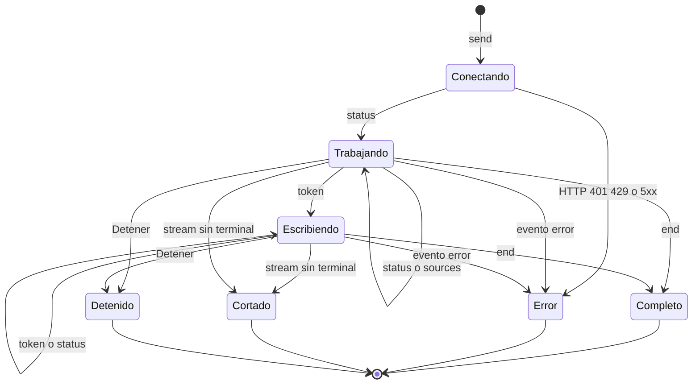

**Invariantes.**

- Una sola petición en curso: `busy` (`App.tsx:80`). Se cumple.
- Todo stream termina en un estado no `streaming`: `finished` (`App.tsx:160-166`). Se cumple.
- El historial solo lleva pares completos de pregunta y respuesta (`App.tsx:86-94`). Se cumple.

**Riesgos.**

1. *verificado*. Detenido se veía como Completo. El `catch` ponía `streaming: false` sin `error`, y el pie mostraba el botón de fuentes sin ninguna marca de "detenida". El texto parcial entraba al historial del turno siguiente como respuesta del asistente. Si el usuario detenía antes del primer token, el historial llevaba un turno de asistente vacío.
   **Arreglado** (commit `d1a4160`): Detener marca el mensaje con `stopped` (`App.tsx:171`), el pie muestra "Respuesta detenida" (`Message.tsx:42-48`) y el par pregunta y respuesta sale del historial (`App.tsx:86-94`).
2. *verificado*. Un Error sacaba del historial la respuesta pero dejaba la pregunta. El turno siguiente enviaba dos mensajes de usuario seguidos.
   **Arreglado** (commit `d1a4160`): la pregunta sale del historial junto con su respuesta fallida (`App.tsx:86-94`).
3. *verificado*, menor. El paso del agente se oculta en cuanto hay texto (`Message.tsx:24`). Durante `verify` el usuario ve el cursor y ningún indicador del paso.
4. *verificado*, sin impacto. `nuevaConversacion` con un stream activo vacía la lista y aborta. El `catch` posterior llama a `updateLast` sobre una lista vacía y escribe el índice `-1`. React lo ignora.

---

## 7. Cadena SLURM de lectura y verificación

**Propósito.** Leer con el modelo de visión todas las páginas del worklist y
contrastar las lecturas de dibujos, en jobs de 8 h encadenados.

**Dónde.**

- `tools/figuras/figuras_job.slurm:31-50` `pendientes()`; `:59-66` decisión de seguir; `:70` sucesor con `afterany`; `:77-81` `cancelar_sucesor`; `:86-112` arranque de vLLM y sus salidas con 1; `:122-123` lectura con deadline; `:134` segunda pasada; `:138-145` regla de progreso; `:147` salida.
- `tools/figuras/extraer_figuras.py:118-131` `cargar_hechos`; `:251-287` tres intentos por página; `:350-354` corte por deadline.
- `tools/figuras/verificar_lecturas.py:94-105` `hechos`; `tools/figuras/pendientes_verificacion.py:31-41`.

**Codificación.** No hay cola persistente. El estado de la cadena es el par
(páginas por leer, lecturas por verificar). Cada job lo recalcula desde
`worklist.jsonl`, `figuras.jsonl` y `verificacion.jsonl`. Una fila con `error`
no cuenta como hecha. El otro componente del estado es si hay un sucesor en la
cola de SLURM.

**Estados y transiciones.**

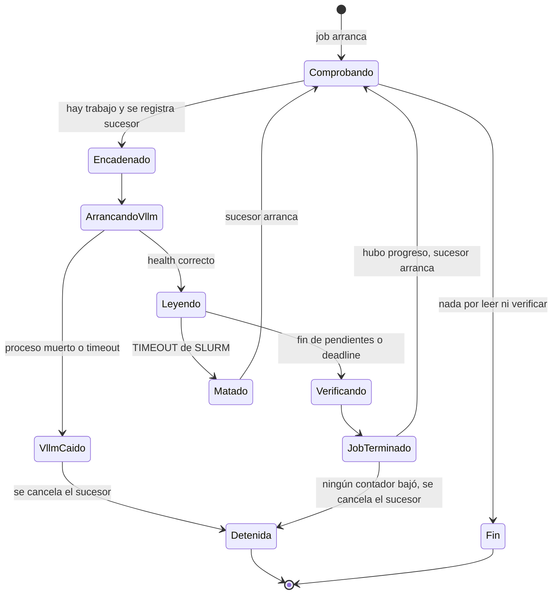

**Invariantes.**

- El sucesor se registra antes del trabajo (`figuras_job.slurm:70`), así sobrevive a un SIGKILL. Se cumple.
- Una página con error se reintenta (`figuras_job.slurm:47`, `extraer_figuras.py:129`). Se cumple.
- La cadena termina cuando no queda trabajo (`figuras_job.slurm:62-66`), cuando vLLM no arranca (`:105-112`) o cuando un job no baja ningún contador (`:138-145`). Se cumple. Un TIMEOUT de SLURM no llega a esas líneas y deja vivo al sucesor.

**Riesgos.**

1. *verificado*. No había estado terminal para una página que falla siempre. Una fila de error nunca cuenta como hecha y no hay contador de intentos entre jobs. El script reconoce "unas pocas páginas que fallan siempre" (`figuras_job.slurm:130-132`). Con una sola de ellas, cada job cargaba el modelo de 27B, reintentaba esa página tres veces y encadenaba otro job. El error `sin_imagen` (`extraer_figuras.py:184`) tampoco cambia sin intervención.
   **Arreglado** (commit `0ab7d55`): un job que no baja las páginas por leer ni las lecturas por verificar cancela su sucesor (`figuras_job.slurm:138-145`). Las filas de error se siguen reintentando cuando alguien relanza la cadena.
2. *verificado*. vLLM que no arranca salía con 1 después de registrar el sucesor (`:70`). Un fallo persistente (modelo ausente, GPU) producía una cadena sin fin de jobs fallidos.
   **Arreglado** (commit `0ab7d55`): las dos salidas de arranque cancelan el sucesor antes de salir (`figuras_job.slurm:105-112`). Un fallo transitorio de un nodo también detiene la cadena, y hay que relanzarla a mano.
3. *verificado*. La segunda pasada tiene la misma regla: las filas de error de `verificacion.jsonl` no cuentan (`pendientes_verificacion.py:40`). Una lectura que el revisor no logra procesar mantiene `VER` por encima de 0.
   **Arreglado** (commit `0ab7d55`): la misma regla de progreso del riesgo 1 cubre `VER`.
4. *hipótesis*. Tolerancia desigual a líneas corruptas. `extraer_figuras.py:118-131` y `pendientes()` ignoran una línea JSON rota. `verificar_lecturas.py` y `fusionar_figuras.py` usaban `json.loads` sin `try`. Una línea truncada por un SIGKILL en mitad de una escritura hacía fallar la verificación en cada job, y la misma línea bloqueaba la fusión.
   **Arreglado** (commit `0ab7d55`): las dos herramientas saltan y cuentan la línea rota (`verificar_lecturas.py:180-186`, `fusionar_figuras.py:322-326`, `:337-341`).
5. *documentado* en `docs/FIGURAS.md`. El sucesor queda congelado con el `.slurm` del momento del `sbatch`.

---

## 8. Estado de una página en el pipeline de figuras

**Propósito.** Seguir cada par (documento, página) desde la detección hasta la
inserción en el vault.

**Dónde.**

- `tools/figuras/prep_figuras.py:34-68` inventario por marcadores; `:71-87` `fusionar_worklist`; `:102-125` render; `:130-136` escritura del worklist.
- `tools/figuras/render_pendientes.py:20-39` render sin rehacer el worklist.
- `tools/figuras/extraer_figuras.py:182-185` imagen y modo rescate.
- `tools/figuras/verificar_lecturas.py:175-198` candidatas.
- `tools/figuras/fusionar_figuras.py:172-196` `util`; `:225-232` decisión por página.

**Codificación.** Presencia de artefactos con la misma clave `doc__pN`: fila en
`worklist.jsonl`, `imgs/<clave>.jpg`, filas en `figuras.jsonl` (append-only,
varias por clave posibles), filas en `verificacion.jsonl`, y la cabecera del
bloque dentro del `.md`. El modo rescate es el prefijo del campo `motivo`.

**Estados y transiciones.**

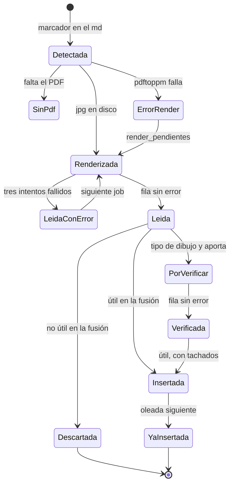

**Riesgos.**

1. *verificado*. `prep_figuras.py` reescribía el worklist entero desde los marcadores del vault. La fusión borra todos los marcadores de cada documento que procesa, también los de páginas aún sin lectura (`fusionar_figuras.py:261-264`). Un nuevo `prep` después de una oleada sacaba esas páginas del worklist. Además, `prep` nunca escribe `motivo` (`prep_figuras.py:58-66`). Las filas de rescate que lee `extraer_figuras.py:185` vienen de un proceso que no está en el repositorio, y un nuevo `prep` las perdía.
   **Arreglado** (commit `0ab7d55`): `fusionar_worklist` conserva las filas previas que el inventario ya no ve y el `motivo` de las que sigue viendo, y el worklist se escribe con renombrado atómico (`prep_figuras.py:71-87`, `:130-136`).
2. *hipótesis*. Imagen parcial. El render da por hecha cualquier `.jpg` existente (`prep_figuras.py:107`, `render_pendientes.py:22`). Un `pdftoppm` muerto a mitad de escritura dejaba una imagen truncada que nadie volvía a renderizar.
   **Arreglado** (commit `0ab7d55`): los dos renders escriben en un nombre temporal y renombran al final (`prep_figuras.py:109-125`, `render_pendientes.py:27-39`).
3. *verificado* el mecanismo, *hipótesis* el disparador. Si una clave tiene dos lecturas correctas, la fusión toma la última (`fusionar_figuras.py:225`) y la verificación salta la clave ya revisada (`verificar_lecturas.py:197-198`). La verificación de la lectura vieja se aplica a la nueva. `marcar_dudosas` lista como aviso incluso los fragmentos que ya no aparecen (`fusionar_figuras.py:111-114`).

---

## 9. Fusión en el vault por oleadas

**Propósito.** Insertar las lecturas útiles en el `.md` y borrar los
marcadores falsos, de forma repetible mientras la extracción avanza.

**Dónde.**

- `tools/figuras/fusionar_figuras.py:34-37` `YA_INSERTADO_RE`.
- `fusionar_figuras.py:211-297` `procesar_documento`: `:229-230` página ya insertada; `:237-238` variables `ya_insertado` y `pendiente`; `:240-250` bloque al cerrar la página; `:253-272` recorrido por líneas; `:285-287` escritura atómica por fichero.
- `fusionar_figuras.py:354-370` respaldo único del vault virgen.
- `tools/figuras/README.md:72-80` motivo del cierre.

**Codificación.** El propio texto del `.md` es el estado. La cabecera
`**Figura de la página N leída…**` o `**Página N recuperada…**` marca
"insertado". La ausencia de `![...]` marca "procesado". Dos variables locales
(`pendiente`, `ya_insertado`) llevan el modo de una línea a la siguiente.

**Estados por página dentro del `.md`.**

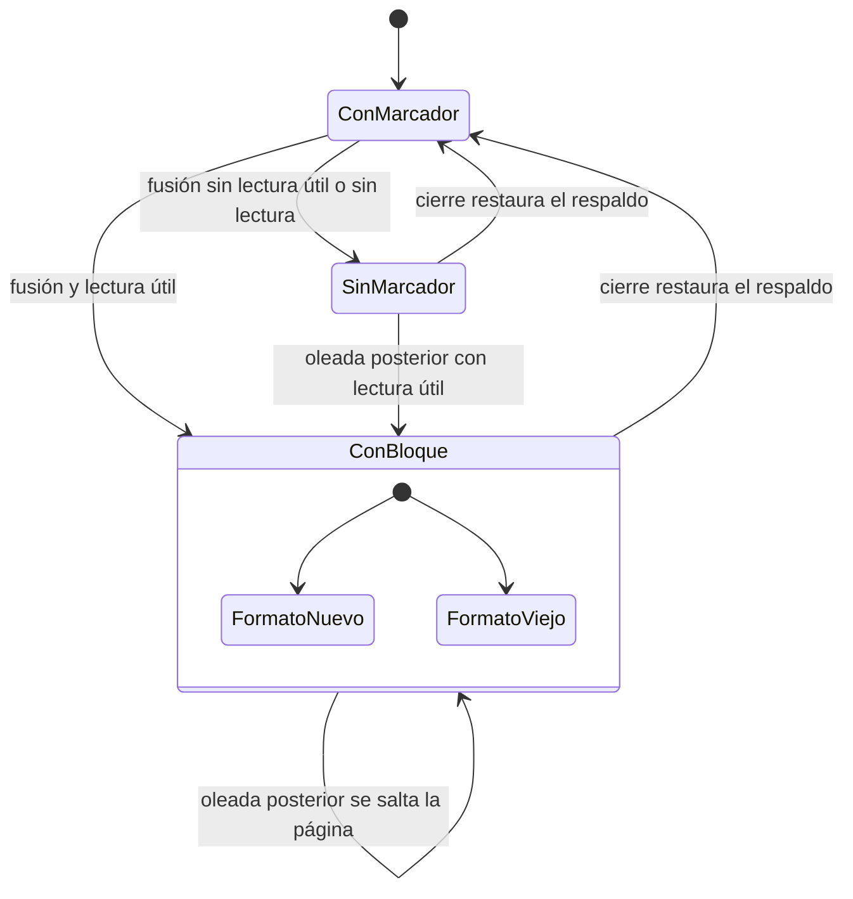

**Invariantes.**

- Idempotencia por cabecera (`fusionar_figuras.py:229`). Se cumple.
- Escritura atómica por fichero (`fusionar_figuras.py:285-287`). Se cumple.
- El respaldo es el vault virgen. La fusión lo crea solo si no existe ninguno en `--salida` (`fusionar_figuras.py:360-362`). El cierre lo comprueba antes de restaurar (`cierre.sh:41-44`).

**Riesgos.**

1. *verificado*. Un bloque de formato viejo no tiene salida dentro de las oleadas. La fusión lo salta (`fusionar_figuras.py:229-230`) aunque cambie el formato. Solo `cierre.sh` lo rehace. Mientras tanto el chunker trata el bloque sin cierre como abierto hasta el final del documento (máquina 10).
2. *verificado*. Si la primera fusión con `--aplicar` corre con un `--salida` nuevo, o alguien limpia ese directorio, el respaldo "virgen" ya está enriquecido. `cierre.sh` restauraba el respaldo más antiguo sin comprobarlo; solo imprimía cuántos documentos llevan sello (`cierre.sh:46`).
   **Arreglado** (commit `7bfe817`): el cierre cuenta los documentos con sello dentro del respaldo antes de extraerlo y sale con 1 si hay alguno (`cierre.sh:41-44`).

---

## 10. Procedencia de las lecturas en el chunker

**Propósito.** Garantizar que todo fragmento con texto leído por el modelo de
visión lleve la cabecera de procedencia.

**Dónde.**

- `backend/src/rag/ingestion/chunker.py:148-181` `ensure_figuras_have_provenance`; `chunker.py:160-161` variables de modo; `chunker.py:172` condición de continuación; `chunker.py:179-181` cierre.
- `chunker.py:33-37` patrones de inicio y fin de bloque.
- `tools/figuras/verificar_enriquecimiento.py:78-83` comprobación sobre el corpus.

**Codificación.** Dos variables locales llevan el modo entre iteraciones:
`activa` (bloque abierto) y `ultima` (última cabecera vista).

**Estados y transiciones.**

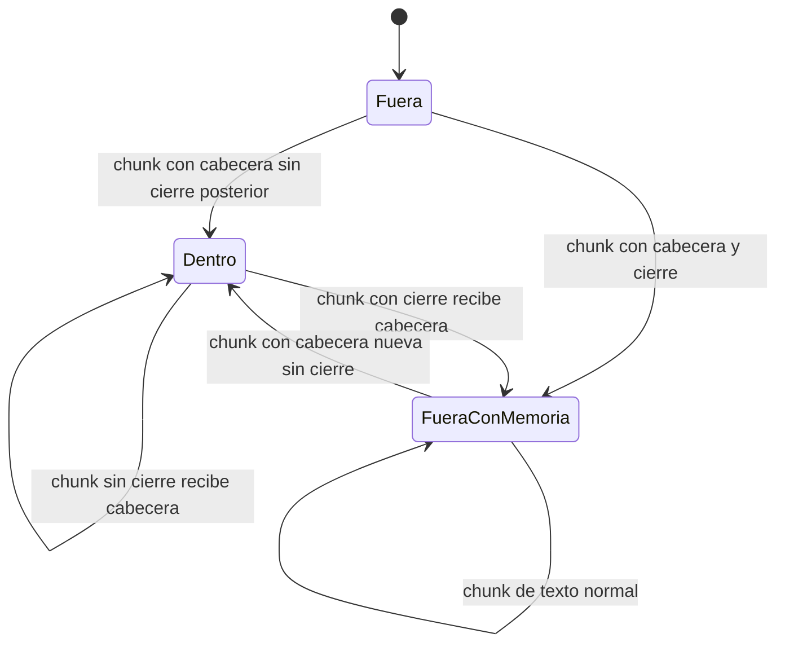

**Invariante.** Ningún fragmento contiene lectura de máquina sin cabecera. Se
cumple para bloques con cierre.

**Riesgos.**

1. *verificado*. Un bloque sin cierre (formato viejo) deja `activa` fija hasta el final del documento, porque solo el cierre la vacía (`chunker.py:179-181`). Todo fragmento posterior, también el articulado del contrato, recibe la cabecera "(continuación)". El error va en la dirección prudente, pero contamina citas y atribuciones. `cierre.sh` lo resuelve al rehacer la fusión.
2. *verificado*. `verificar_enriquecimiento.py:81` solo comprueba fragmentos que contienen el cierre. Un fragmento intermedio de un bloque largo que perdiera la cabecera no se detecta. Hoy el chunker cubre ese caso; el verificador no protegería una regresión.

Fuera de estos dos puntos, la máquina es sana.

---

## 11. Esquema de puntos y colección en Qdrant

**Propósito.** Mantener la colección, sus índices y el formato del payload
compatibles con lo que espera el retrieval.

**Dónde.**

- `backend/src/rag/ingestion/indexer.py:69-86` `ensure_collection`; `indexer.py:78` solo crea si falta; `indexer.py:276-277` dimensión del embedder.
- `indexer.py:88-128` índices de payload; `indexer.py:130-180` `backfill_norm_fields`; `indexer.py:215-240` payload con `tipo` en minúsculas y espejos `*_norm`.
- `backend/src/rag/retrieval/store.py:37-69` filtros: `*_norm` (`store.py:44-53`) y doble grafía de `tipo` (`store.py:59-66`).
- `backend/src/rag/config.py:37` modelo de embeddings.
- `backend/src/rag/api/main.py:278-311` health.

**Codificación.** No hay campo de versión. La versión de cada punto se infiere
de la presencia de `*_norm` y de la grafía de `tipo`. La dimensión de la
colección queda fija al crearla. Ningún sitio guarda el modelo de embeddings.

**Estados.**

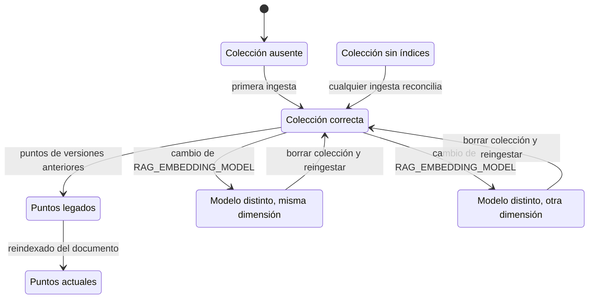

**Riesgos.**

1. *verificado* el código, *hipótesis* la existencia de puntos legados. `backfill_norm_fields` (`indexer.py:130`) no tiene llamador en el repositorio. Un punto legado solo pasa a Actual si su documento se reindexa. Los filtros por razón social y suministrador buscan en `*_norm` (`store.py:44-53`) y no encuentran esos puntos. Con filtro de la UI no hay reintento sin filtro, y la pregunta termina en Sin contexto. El comentario de `store.py:60-62` sugiere que el índice histórico tiene puntos legados.
2. *verificado*. Cambio de modelo de embeddings. `ensure_collection` no recrea una colección existente (`indexer.py:78`), tampoco con `--force`. Con otra dimensión falla cada upsert, y cada búsqueda densa de la API lanza una excepción que termina en `error`. Con la misma dimensión, los documentos al día se saltan por hash, conservan vectores del modelo viejo, y la búsqueda densa compara vectores de dos modelos sin aviso. `/api/health` solo comprueba que el modelo exista en Ollama (`main.py:303-311`).
3. *verificado*. Con la colección ausente (despliegue nuevo antes de la primera ingesta), `store.count` lanza una excepción y `/api/health` informaba `qdrant: error` aunque Qdrant respondiera.
   **Arreglado** (commit `1e5b90a`): el health pregunta si la colección existe y responde `qdrant: ok` y `collection: missing`, con estado degradado (`main.py:281-296`, `store.py:257-258`).

---

## 12. Cuota diaria por IP

**Propósito.** Limitar las preguntas sin clave a N por IP y día UTC.

**Dónde.**

- `backend/src/rag/api/quota.py:66-93` `hit`: `quota.py:76-81` UPSERT; `quota.py:83-91` rechazo sin inflar; `quota.py:95-102` `refund`; `quota.py:114-122` poda una vez por día de proceso; `quota.py:28-32` segundos hasta la medianoche UTC.
- `backend/src/rag/api/main.py:185-224` `chat_access` y `consume_quota`; `main.py:420-423` cabecera `X-Quota-Remaining`.
- `frontend/src/api.ts:63-75` lectura de la cuota; `frontend/src/App.tsx:28`, `:344` aviso.

**Codificación.** Filas `(ip, day, count)` en SQLite. El día es una cadena de
fecha UTC: el paso de día es implícito, porque cambia la clave. `_pruned_day`
recuerda la última poda.

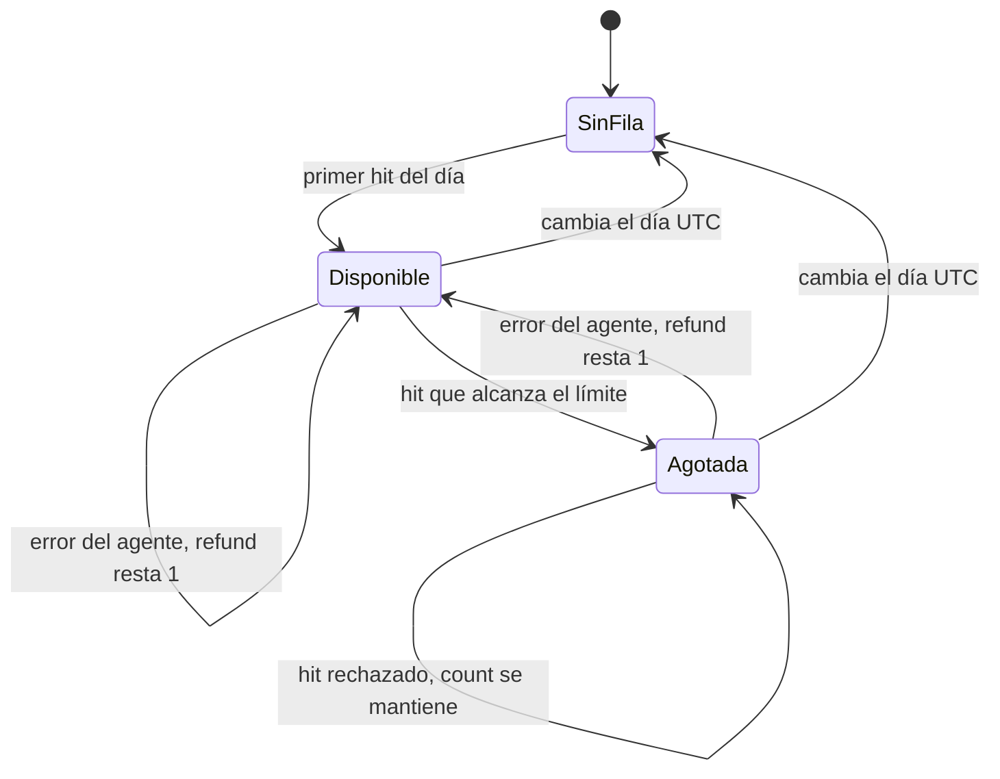

**Invariantes.** Incremento atómico bajo cerrojo (`quota.py:74-81`). Los
rechazos no inflan el contador (`quota.py:83-91`). El contador sobrevive a un
redeploy (volumen `quota_state`). Se cumplen. La máquina del backend es sana.

**Riesgos.**

1. *verificado*. El intento se consumía aunque la respuesta fallara o el usuario la detuviera (máquina 5, riesgo 1).
   **Arreglado** (commit `65c2d78`) para el error del agente y la petición mal formada. Detener y un corte de red siguen contando, por diseño.
2. *verificado*. Tras guardar una API key, `quotaRemaining` conservaba el último valor. Con clave válida el backend no envía `X-Quota-Remaining`, y `api.ts:74-75` solo actualiza cuando la cabecera existe. El aviso "Agotaste tus preguntas de hoy" seguía visible con acceso ilimitado hasta recargar.
   **Arreglado** (commit `65c2d78`): guardar la clave vacía `quotaRemaining` (`App.tsx:249`).
3. *verificado*, menor. `Retry-After` valía siempre 86400. No coincidía con la medianoche UTC que anuncia el mensaje.
   **Arreglado** (commit `65c2d78`): `Retry-After` lleva los segundos hasta la medianoche UTC (`main.py:222`, `quota.py:28-32`).

---

## 13. Salud del servicio

**Propósito.** Informar a Docker y al usuario si el backend puede responder.

**Dónde.** `backend/src/rag/api/main.py:255-319`; `backend/Dockerfile:52-53`;
`frontend/src/App.tsx:46`.

**Codificación.** Dict `out` con `status` (`ok` o `degraded`), un campo por
componente (`qdrant`, `collection`, `ollama`, `missing_models`) y HTTP 200 o
503.

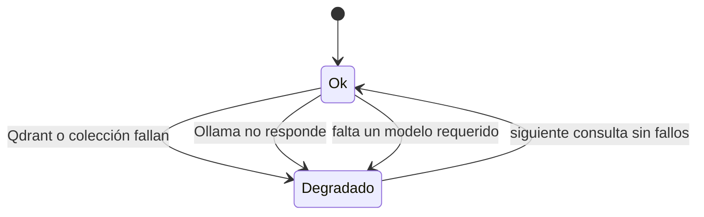

**Riesgos.**

1. *verificado*. Con `RAG_LLM_PROVIDER=deepseek`, el health no prueba DeepSeek (`main.py:303-307`). Informa `ok` con el proveedor de generación caído.
2. *verificado*. El frontend lee la salud una sola vez al montar (`App.tsx:46`). El indicador no cambia durante la sesión.
3. *hipótesis*. El docstring del health esperaba que `restart: unless-stopped` reaccionara a `unhealthy`. Docker sin Swarm no reinicia un contenedor por ese motivo; la marca solo informa.
   **Arreglado** (commit `1e5b90a`): el docstring ya no lo promete (`main.py:259-263`). El comportamiento de Docker no cambia.
4. Colección ausente informada como Qdrant caído: ver máquina 11, riesgo 3. **Arreglado** (commit `1e5b90a`).

---

## 14. Bucles de reintento

**Dónde.**

- `backend/src/rag/ingestion/embedder.py:52-86` `_embed_batch`: contador `attempt`, backoff exponencial, sin espera tras el último intento.
- `tools/figuras/extraer_figuras.py:251-287` y `tools/figuras/verificar_lecturas.py:145-163`: tres intentos por página con espera lineal.

**Codificación.** Un contador local y una excepción guardada.

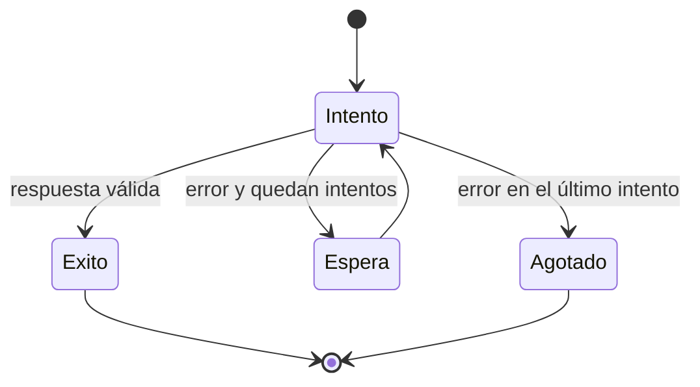

**Valoración.** Dentro de un proceso los tres bucles son sanos y acotados. La
sonda de dimensión (`embedder.py:48`, llamada en `indexer.py:276`) falla antes
de tocar el índice si Ollama no responde, y la CLI sale con 1. Entre jobs
SLURM la regla de progreso detiene la cadena (máquina 7). Las
llamadas al LLM del grafo no tienen reintento propio (máquina 3, riesgo 5).

---

## Patrones transversales

**P1. Estado como presencia más hash.** El sistema decide "hecho" por la
existencia de algo: un `.jpg`, una fila sin `error`, una cabecera en el
`.md`, un `source_hash` en el payload. Esto da idempotencia barata. Falla en
dos casos: cuando la presencia no implica completitud (imagen truncada,
upsert parcial) y cuando el hash no cubre el contenido real (hash del PDF
frente a `.md` enriquecido).

**P2. Errores sin contador.** "Una fila con error no está hecha" aparece en
`extraer_figuras.py`, `figuras_job.slurm`, `verificar_lecturas.py` y
`pendientes_verificacion.py`. Sin contador de intentos, un error permanente
crea un estado sin salida que se reintenta en cada pasada. La cadena SLURM ya
tiene una salida: un job sin progreso no encadena otro. La ingesta ya no
aplica esta idea al documento vaciado.

**P3. Listas de trabajo efímeras.** `worklist.jsonl`, `docs_a_reindexar.txt` y
`docs_con_figura.txt` se sobrescriben en cada pasada con lo que cambió en esa
pasada. Lo pendiente de pasadas anteriores se pierde. El modo `sello` corrige
esto para una parte de los documentos porque deriva la lista de un estado
durable (el frontmatter). El cierre recupera el resto, y `prep_figuras.py` ya
conserva las filas del worklist anterior.

**P4. Booleanos de tres valores y campos opcionales.** `grounded: bool | None`
y los campos de `ChatMessage` codifican resultados distintos. Queda una
colisión en el evento `end`: Sin verificar y Rechazo comparten campos. Detenido
ya lleva `stopped` y Sin contexto lleva `grounded: null`.

**P5. Estado reconstruido en paralelo.** `final` en el SSE copia el estado del
grafo. `existing` en la ingesta copia el estado del índice al inicio de la
corrida. `pendientes()` en el `.slurm` reimplementa `cargar_hechos`. Cada copia
es correcta hoy y diverge en silencio si la fuente cambia de forma.

**P6. Códigos de salida perdidos.** Las tuberías `| tail` en `aplicar_oleada.sh`
y `cierre.sh` ocultaban el resultado de la ingesta. Los dos scripts usan ya
`pipefail` y cortan con 1 cuando la ingesta o el build fallan.

**P7. Ventanas no atómicas entre procesos.** Borrado y upsert en Qdrant,
restauración y fusión en Khipu, fusión y rsync hacia el Mac. Ningún cerrojo
coordina la ingesta de launchd, la ingesta manual y la API.

**P8. Degradación silenciosa.** Búsqueda léxica que cae a solo densa y puntos
legados que los filtros no encuentran. Cada caso solo deja una línea de log.
La verificación que no corre ya lleva la marca "Sin verificar".

### Riesgos que más conviene atender

1. **Desfase entre vault e índice tras el enriquecimiento** (máquina 2). Guardar en el payload un hash del `.md` y compararlo en la ingesta normal. Ya hecho: `pipefail` en los dos scripts y el cierre reindexa los documentos que solo perdieron marcadores.
2. **Cambio de modelo de embeddings sin registro** (máquina 11). Guardar el modelo en la colección y negarse a indexar o a servir si no coincide.
3. **Renombrado masivo** (máquina 1). Purgar antes de indexar cuando la purga se va a retener, o avisar de los duplicados.
4. **Puntos legados sin `*_norm`** (máquina 11). Llamar a `backfill_norm_fields` desde la ingesta o eliminarlo.
5. **Rechazo y Sin verificar con los mismos campos** (máquina 3). Añadir al evento `end` un campo que diga si la pregunta se rechazó.

### Riesgos que siguen abiertos y por qué

- Necesitan una decisión de producto o de operación: 1.1 (la ventana de ausencia; invertir el orden de upsert y borrado cambia el modo de fallo hacia dos generaciones), 1.3 (renombrado masivo), 1.5 (cerrojo entre corridas), 2.3 (hash del `.md` en el payload; obliga a reindexar todo el índice una vez), 3.2, 3.3, 3.5, 4.2, 11.1 y 11.2.
- Comportamiento aceptado o documentado: 1.6 (nadie lee el manifiesto), 2.6 (el cierre reinicia el backend), 3.6 y 6.3 (avisos de interfaz), 5.4, 6.4, 7.5, 9.1 y 10.1 (el cierre los resuelve), 13.1 (probar DeepSeek en cada healthcheck tiene costo) y 13.2.
- Hipótesis sin confirmar y sin un arreglo pequeño: 1.4, 2.4, 2.5, 3.4, 5.2 y 8.3.
- Latentes, sin fallo hoy: 5.3 y 10.2.
